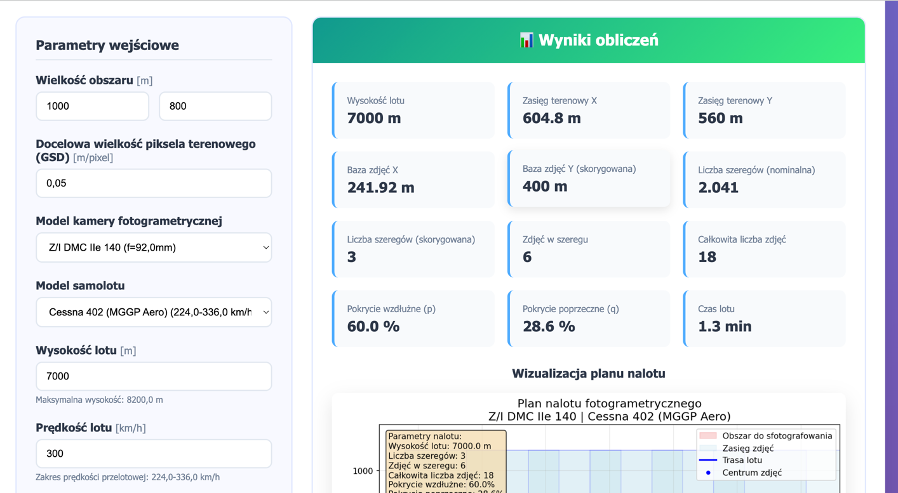
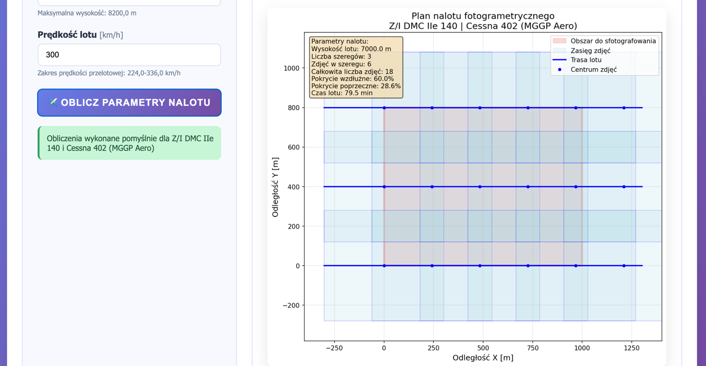

# Photogrammetric Flight Planner

**Plan image acquisition from camera geometry, ground sample distance and overlap requirements.**

Python · Django · Matplotlib · photogrammetry · numerical geometry

This educational application calculates aerial image footprints, altitude, strip spacing, image count and estimated flight duration, then renders the acquisition layout. It connects geometric camera models with the data acquisition stage of a computer vision workflow.

## Capabilities

| Input | Result |
| --- | --- |
| Area width/height and target GSD | Required altitude and image footprint |
| Sensor dimensions, focal length and pixel pitch | Camera-dependent ground coverage |
| Optional altitude override | Recomputed effective GSD and footprint |
| Aircraft operating range and speed | Validated flight parameters and duration |
| Along-track/across-track overlap | Strip spacing and required image count |




## Quick start

Python 3.12 is the tested web runtime.

```bash
git clone https://github.com/Korniszon99/fotogrametia_projekt_nalotu.git
cd fotogrametia_projekt_nalotu
python -m venv .venv
source .venv/bin/activate
python -m pip install -r requirements.txt
cp .env.example .env
python manage.py migrate
python manage.py runserver
```

Open <http://127.0.0.1:8000/>. Initial camera and aircraft examples are added when the empty planner is opened. On Windows use `.venv\Scripts\activate`.

For a local container demo: `docker compose up --build`. The container uses Gunicorn and persists SQLite in a named volume. The supplied Compose configuration is a localhost demo with debug enabled.

## Geometry and units

For focal length `f` in mm and pixel pitch `p` in µm:

`altitude_m = f_mm × GSD_m_per_px × 1000 / p_µm`

`footprint_m = sensor_size_mm × GSD_m_per_px × 1000 / p_µm`

An altitude override changes the effective GSD. The current target overlaps are 60% along-track and 30% across-track. The corrected number of strips preserves the minimum across-track overlap. API `flight_time` is in **seconds**; the interface and plot show **minutes**.

## Test and deployment

```bash
python manage.py test
python manage.py makemigrations --check --dry-run
```

Tests cover physical units, overlap, altitude overrides, invalid inputs, resource limits and CSRF. Inputs must be finite and positive; visualizations are capped at 2,000 images. POST endpoints use Django CSRF protection.

For HTTPS deployment set `DJANGO_DEBUG=0`, a strong random `DJANGO_SECRET_KEY`, explicit `DJANGO_ALLOWED_HOSTS`, trusted origins and a persistent `DJANGO_DB_PATH`. Enable `DJANGO_TRUST_PROXY=1` only behind a proxy that overwrites the forwarded protocol header. Run `python manage.py check --deploy`; configure backups and health monitoring.

**Scope:** a flat-ground planning model for vertical imagery. It does not model terrain, wind, turns, airspace constraints, drone autopilot missions or operational flight safety. This is a geometry demo, not an operational navigation system. The duration estimate excludes turns and takeoff/landing.

For a CV portfolio, pair the planner with a reconstruction case study showing how GSD and overlap affect data quality. [Security notes](SECURITY.md).
